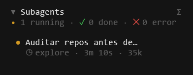

# subagent-monitor

OpenCode V2 sidebar for child-session progress, recent completed work and navigation. Uses public V2 events/session data, not SQLite or status files.

## Screenshots



## Install

Requires OpenCode V2 (plugin API 2.0.26) and Node.js 22+ for setup/tests. No npm release is required.

```sh
git clone https://github.com/Thiago-P05/subagent-monitor.git
cd subagent-monitor
npm ci --ignore-scripts --omit=optional
npm test
```

Merge into global `~/.config/opencode/cli.json`, or its `XDG_CONFIG_HOME` location, preserving other settings:

```json
{ "plugins": ["/absolute/path/subagent-monitor"] }
```

OpenTUI/Solid peers are supplied by the CLI host; they are optional for headless tests. Start a new interface. Avoid enabling another subagent sidebar plugin simultaneously. Remove this entry to disable.

## Use

`Alt+B` focuses/releases the list. While focused: `j/k` or arrows select, Enter opens the child session, `c` toggles recent history, `h/l` collapse/expand, Escape returns to the prompt. Palette commands toggle the section and history. Navigation keys are not global prompt shortcuts.

## Privacy and limits

Session titles, agent/model names and summaries may be shown. Label sanitization suppresses known token-like values but is not a guarantee against arbitrary personal information; inspect the display before sharing. Runtime state is in memory; the plugin does not write status files or credentials and does not send data to a third-party endpoint. OpenCode remains responsible for its own session storage and any configured server.

Events missed before loading may not be reconstructable. Recent-history retention is bounded in memory; it is not a durable audit log. Node tests verify event logic, keymaps and render structure with mocks, not visual behavior in a real terminal. Tests use fabricated `TESTTOKEN` strings and a private-key header without any key body.

## Credits

Related project reviewed: [Joaquinvesapa/sub-agent-statusline](https://github.com/Joaquinvesapa/sub-agent-statusline), MIT. Similar functionality alone is not proof of derivation; see [NOTICE](NOTICE) for the comparison scope and preserved upstream license notice.

MIT — [LICENSE](LICENSE). [V2 CLI plugins](https://opencode.ai/v2/docs/cli/plugins) · [Repository](https://github.com/Thiago-P05/subagent-monitor).
